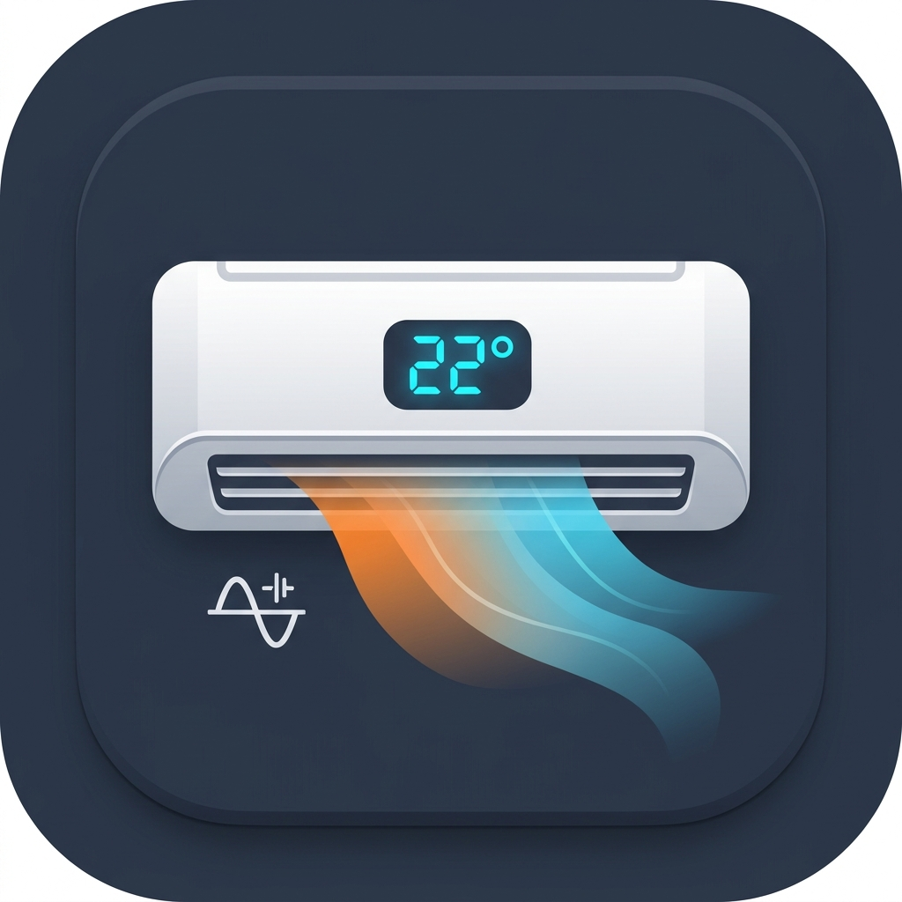

# HA Thermostat Split (Home Assistant)

<p align="center">
  
</p>

Thermostat **virtuel par pièce** qui pilote un split réel (entité `climate`) avec régulation continue Inverter, apprentissage anti-yoyo et protection compresseur :

- **Moyenne des capteurs de température de la pièce** (corrige le biais de la sonde intégrée au split).
- **Modulation continue Inverter** : ajuste dynamiquement la consigne envoyée au split pour faire moduler le compresseur à basse puissance plutôt que de faire de simples cycles Tout-ou-Rien.
- **Apprentissage statistique anti-yoyo** : anticipe l'inertie thermique de la pièce en mesurant la vitesse de montée en température ($dT/dt$) et apprend le biais réel de la sonde du split au fil des cycles.
- **Délai anti-spam paramétrable** : 90 secondes par défaut entre deux commandes pour protéger les liaisons (cloud ou infrarouge).
- **Suivi de la puissance électrique totale de la PAC** : compresseur considéré en marche si puissance > seuil (45 W par défaut).
- **Coordination multi-split intelligente** : partage le compresseur entre plusieurs pièces (démarrage libre si le compresseur tourne déjà, arrêt libre si une autre pièce chauffe).

---

## Installation

1. Copie le dossier `custom_components/ha_thermostat_split` dans votre dossier `<config>/custom_components/`.
2. Redémarre Home Assistant (2024.12 ou plus récent).
3. Va dans **Paramètres** → **Appareils et services** → **Ajouter une intégration** → **HA Thermostat Split**.
4. Configure une entrée par pièce (crée une entité `climate` virtuelle par pièce). Les réglages se modifient à tout moment via **Configurer**.

Pour activer les journaux détaillés :
```yaml
logger:
  logs:
    custom_components.ha_thermostat_split: debug
```

---

## Principe de fonctionnement

### 1. Régulation Inverter modulante
Au lieu d'imposer un 24 °C fixe qui force la PAC à souffler à pleine puissance, l'intégration calcule dynamiquement :
$$\text{Consigne envoyée au split} = T_{split} + \text{Offset}$$

- **Chauffe rapide** (pièce froide, écart important) : $\text{Offset} \approx +3.0 \text{ °C}$ $\rightarrow$ la PAC monte en puissance.
- **Approche de la cible** : l'offset diminue proportionnellement.
- **Maintien à la cible** : $\text{Offset} \approx +0.5 \text{ °C}$ $\rightarrow$ la PAC module à sa **puissance minimale technique** sans couper son compresseur.
- **Arrêt complet** : uniquement si, malgré la modulation minimale, la pièce dépasse `cible + tolérance haute`.

### 2. Apprentissage anti-yoyo
Pour éliminer les dépassements intempestifs (*overshoots*) :
- L'algorithme calcule la pente de montée en température ($dT/dt$ en °C/h).
- Il applique une **avance d'inertie** ($K_{anticipation} \times \frac{dT}{dt}$) pour basculer en puissance minimale **avant** que la pièce ne dépasse la cible.
- À la fin de chaque cycle, il mesure l'éventuel dépassement et réajuste automatiquement son coefficient d'inertie.
- Les données apprises sont sauvegardées de façon permanente dans le stockage interne de Home Assistant.

### 3. Protection du compresseur (cycle minimal)
| Situation | Règle |
|---|---|
| Pièce sous `cible - tolérance basse` | Démarrage, si la pause minimale est écoulée (ou compresseur déjà actif, ou autre pièce en chauffe) |
| Pièce au-dessus de `cible + tolérance haute` | Arrêt, si la durée de marche minimale est écoulée |
| Cycle minimal non terminé | Maintien en chauffe jusqu'au **dépassement maximal** (`cible + dépassement maxi`) |
| Pause minimale non écoulée | Attente, sauf en cas de **sous-chauffe maximale** (`cible - sous-chauffe maxi`) |
| Perte des capteurs depuis `failsafe` min | Arrêt de sécurité automatique |

---

## Attributs exposés par l'entité

- `temperature_split` : Température mesurée par la sonde interne du split.
- `biais_capteur_split` : Écart instantané ($T_{split} - T_{piece}$).
- `consigne_envoyee_au_split` : Consigne courante transmise au split réel.
- `statut_inverter` : Mode inverter en cours (chauffe rapide, modulation intermédiaire, modulation minimale).
- `offset_inverter` : Offset en °C appliqué sur la sonde du split.
- `vitesse_chauffe_deg_h` : Vitesse de montée en température observée (°C/h).
- `inertie_anticipee_min` : Durée d'anticipation apprise par le système (en minutes).
- `biais_appris` : Biais split/pièce mémorisé en régime de maintien.
- `compresseur_actif` / `compresseur_depuis_min` : État et durée du cycle du compresseur.
- `cycles_aujourdhui` / `cycles_courts_aujourdhui` : Statistiques de la journée.
- `decision` : Explication en clair du comportement actuel.

---

## Tests

Pour exécuter les tests unitaires (logique pure, inverter, apprentissage et simulation thermique 2 nœuds) :
```bash
python -m unittest discover tests -v
```
